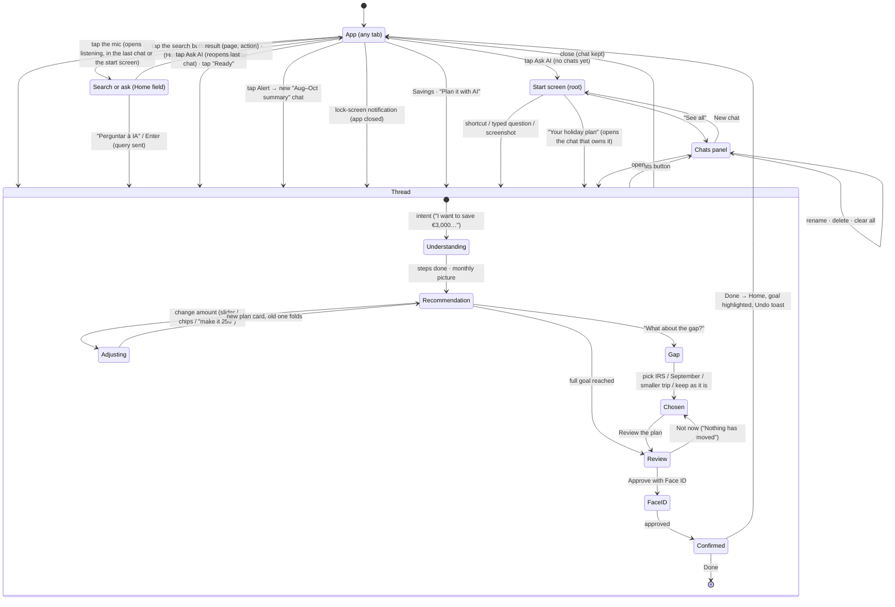
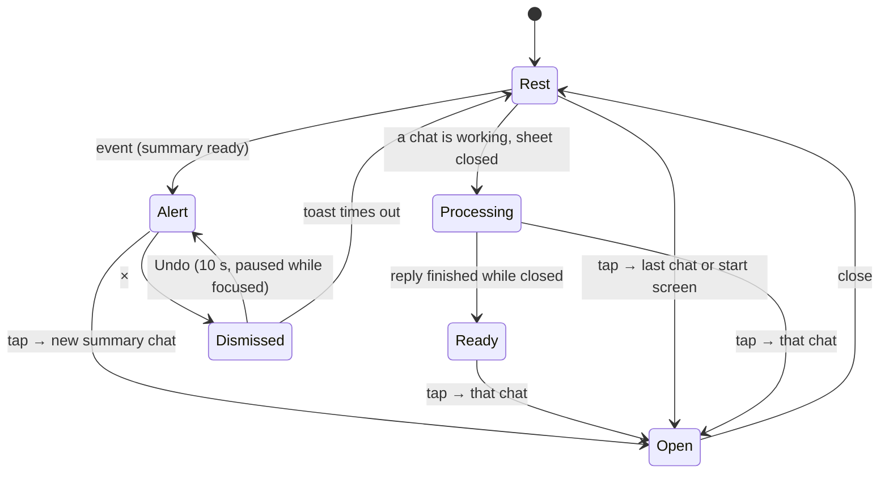
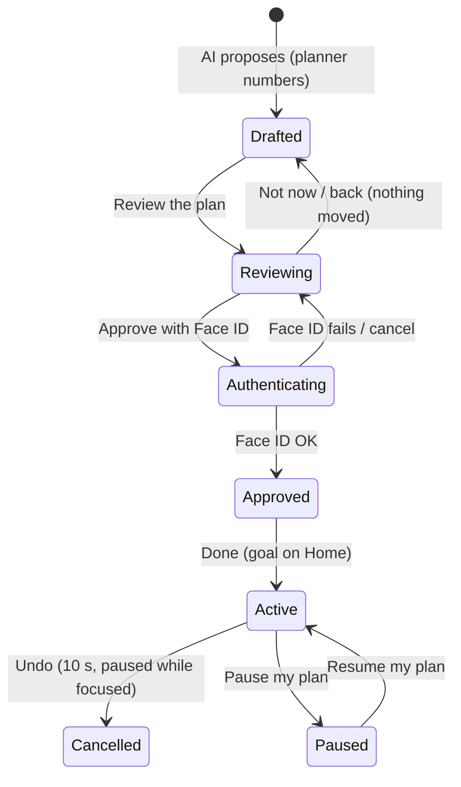
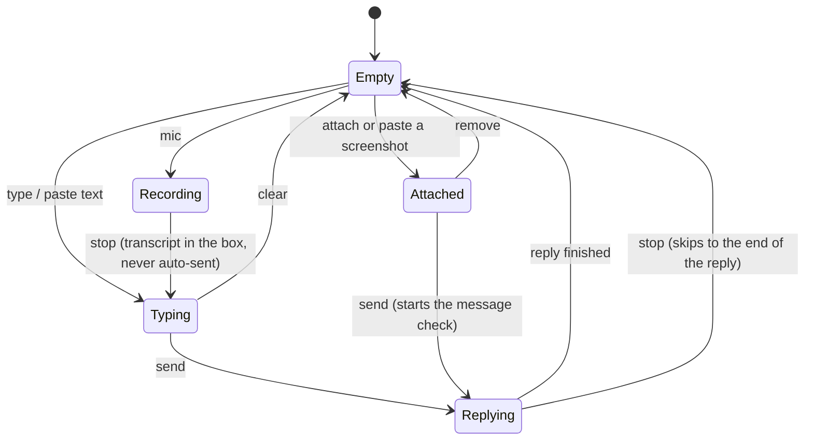

# STATES.md · State diagrams

How the stateful parts behave, for developers and AI agents. Written from the code on 4 Nov 2026; each diagram names the file that implements it. Renders on GitHub (Mermaid). If the flow changes, change the diagram in the same commit.

Purely visual components (Button, Row, StatusBadge, ProjectionChart) have no states worth drawing.

---

## 1. The assistant: entry, threads and J1 (`prototype/src/assistant.tsx`, `conversation.tsx`)

How you get in, where you land, and the core journey inside a thread.

Rules the diagram encodes:
- One plan per person: asking to save in another chat points to the chat that owns the plan ("Open that chat"), never starts a second one.
- Closing never loses a chat; deleting a chat never undoes an approval.
- Money only moves after Review → Face ID. Nothing else in the diagram moves money.

## 2. `AssistantPill` and the sphere button (`components.tsx` · `AssistantPill`, `shell.tsx` · `sphere-fab`)

The assistant asleep. Home shows the full pill; other tabs show only the sphere with the same states (a dot for alert/ready, faster sphere for processing).

Stroke rule (D2): rest, alert and ready = gradient stroke (act on); processing = rotating gradient (AI working).

Labels: Rest "Ask AI" · Alert "Your Aug–Oct summary is ready · View" · Processing "Working on: <chat>" · Ready "Ready: <chat> · Open".

## 3. `ApprovalRequest` / review (`conversation.tsx` · review screen) — the code-handoff component

What the user signs is exactly what executes: amount, from, to, first and last date, number of transfers (PSD2 dynamic linking, `design/SECURITY.md`). Anything outside the payload (Christmas allowance, holiday allowance) is listed as "Not part of this approval".

## 4. `PromptBox` (`components.tsx` · `PromptBox`)

Main button: mic (Empty) · send (Typing/Attached) · stop (Replying, Recording).

## Message hierarchy (`chat.tsx` · `AiReply`)

Three levels, so the important things stand out: **status** (quiet muted progress line, e.g. "Checking your account…"; no typing dots) · **reply** (plain body text) · **callout** (key result: the plan, the spending summary, the scam verdict; the only messages with the gradient rule). The steps receipt is neutral ("Worked for 2 s ›"), not coloured.

---

## J1 coherence rules (4 Nov)

- One progress element per answer: the steps receipt, titled ("Checking your account, Aug–Oct"), collapsing to "Worked for 2 s ›".
- Fold only what came before your latest message; the current answer stays open.
- Every promise in the copy has a control ("keep the plan as it is" is a button).
- Chat speaks as the assistant ("I'll ask…"); bank screens (review, confirmation) speak as the bank ("You'll be asked…").
- A shortfall stays visible to the end: review repeats it when the plan doesn't reach the goal.

## Gaps found while drawing these (4 Nov)

Drawing the diagrams from the code turned up these. Fixed ones are marked.

1. **Fixed:** "Save for something" after a plan existed went nowhere ("I can't help with that yet"). Now it opens the plan.
2. **Fixed:** with several chats, a second "Save for something" would have started a second plan. Now it points to the chat that owns it.
3. **Decided (George, 4 Nov):** Face ID failure is a Figma frame only; the prototype always succeeds.
4. **Decided:** no reminder for a plan left at "Not now" (out of scope, low value). The draft stays in its chat.
5. **Decided:** the prototype's alert is "summary ready" only; money arrived and short month stay as Figma wireframes (page 5).
6. **Decided:** keep Pause where it is (chat suggestions and the goal).

## Motion (5 Nov)

iOS conventions, one curve (`--ios`: cubic-bezier(.32,.72,0,1)), Reduce Motion turns all of it into instant changes.
- Assistant opens as a **page sheet**: slides up (0.55 s) while the app scales to 92 %, dims and rounds behind it; status bar turns white on black. Closing reverses it.
- Review / confirmation **push** in from the right (0.55 s); the chat and header parallax 26 % left and dim.
- Tabs cross-fade with a 10 px rise (0.38 s). Bottom sheets spring up; scrims fade.
- Bank pages: app bar turns translucent with a hairline once content scrolls under it; the compact title fades in when the large title leaves.
- Thinking: the sphere plus one gradient dot gliding left–right on a short track while it pulses (replaced the three bouncing dots, 6 Nov).
- Writing: replies stream word by word with a soft ink reveal (each word drawn left to right, blur 2 px → 0, 0.36 s). Same Inter type; a handwriting font was ruled out for legibility and tone in a bank.
- Figma prototype uses the same: MOVE_IN/OUT for the sheet, PUSH for review, SMART_ANIMATE inside the chat.
